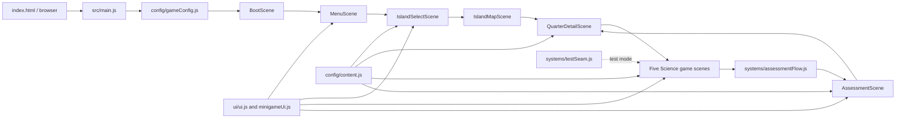

## For future agent

This is the code architecture map for [[wiki/projects/LUMIFY]], scanned on 2026-10-10. It describes the current standalone Phaser prototype; proposed Library, eight-realm map, narrative state, and Laravel integration are documented elsewhere and must not be assumed present. There is no Git commit anchor in this workspace, so recheck source before implementing.

<!-- @generated:start -->
## Scope and evidence

The deterministic `architect_scan.py` scan on `D:\NEW CAPS\PhaserGame` found a Node/JavaScript project with four core directories: `src/scenes`, `src/config`, `src/systems`, and `src/ui`. `package.json` declares Phaser `^3.90.0`, Vite `^5.4.11`, Pixelify Sans, and Playwright; the game starts in `src/main.js`. The scan found no `.git` metadata. The facts below are grounded in those files and `LUMIFY_GAME_SIDE_AUDIT.md` **as of 2026-10-10**.

## Flow

`src/main.js` loads the font and creates one `Phaser.Game`. `BootScene` preloads the two backgrounds, three island images, and Vulcan map before starting the menu. The world selector currently has three islands: Vulcan available, Numeric and Reading locked. Only Vulcan has a live map and five Q1 Mixtures mini-games; a shared `AssessmentScene` handles their four formative and one summative assessments. The game uses `this.scene.start(...)` and transient scene data; no persistent story/restoration store or Laravel API client is visible in this repository.

## Core modules

- [[wiki/projects/LUMIFY/Architecture/Architecture - Scenes]] — navigation, activity scenes, assessments, and local presentation state.
- [[wiki/projects/LUMIFY/Architecture/Architecture - Config]] — canvas/scene registration and static islands, lessons, games, and assessments.
- [[wiki/projects/LUMIFY/Architecture/Architecture - Systems]] — assessment handoff and test-only browser seam.
- [[wiki/projects/LUMIFY/Architecture/Architecture - UI]] — shared Phaser text, buttons, modals, laboratory HUD, icons, and feedback.

Support surfaces: `public/assets` holds current PNG backgrounds/islands/maps; `tests/smoke.spec.js` exercises flows through Playwright; `docs/lore` and `docs/art-direction` contain narrative and visual **proposals**, not runtime modules.

## Personas

- **Grade 6 learner** — explicitly stated as the intended audience in the project briefs; uses the pointer-driven game.
- **Teacher/educator** — intended educational stakeholder from the briefs, but no teacher UI or analytics client is present here (confidence: speculation about workflow).
- **Game developer/designer** — maintains scenes, content, tests, and future visual integration (confidence: speculation as an operational role).

## Recency and decisions

`scanned-commit` is empty because the codebase has no available Git metadata. See [[wiki/projects/LUMIFY/Architecture/Architecture - Key decisions]] for what is observed versus what remains unverified, and `docs/art-direction/LUMIFY_VISUAL_DIRECTION.md` for the proposed map and UI direction. Re-run the deterministic scan when the code changes; refresh only generated blocks in these notes.
<!-- @generated:end -->
